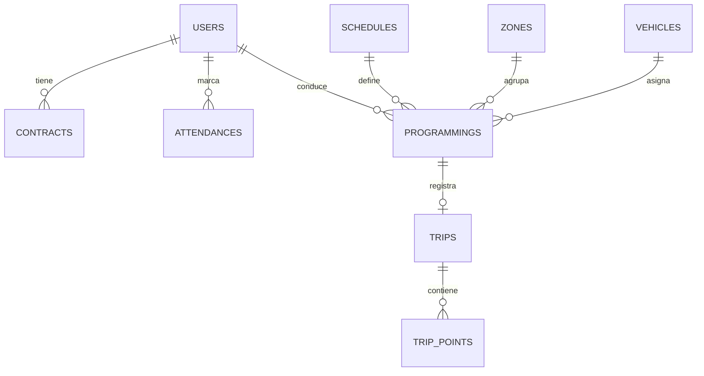

# Base de datos

El modelo incluye catálogos, coordenadas de zona, personal en `users`, permisos, ayudantes de programación, vacaciones, feriados y bitácora. La consulta móvil se calcula con las relaciones existentes, sin migración ni duplicación de datos. El avance operativo agrega 16 migraciones sobre las de `main`. Se comprobó su aplicación sobre una copia SQLite de laboratorio migrada desde main. Antes de aplicar a una base operativa, clonar y respaldar datos, probar con la misma versión de MySQL y comparar integridad, índices y cuentas.
