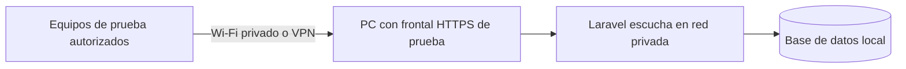

# Despliegue de laboratorio

El estado operativo V4.1 usa MySQL 8.4 en el PC de laboratorio. Consulta el [informe de despliegue](despliegue/INFORME_FINAL_DESPLIEGUE.md) y la [comparativa con fuentes actuales](despliegue/COMPARATIVA_COSTO_CERO.md).

## Antecedente V2

La alternativa elegida usa un PC existente y SQLite local. Coste contratado S/ 0. El consumo eléctrico y la disponibilidad dependen del PC.

| Opción | Persistencia y acceso | Límites |
| --- | --- | --- |
| PC + Wi-Fi privado | SQLite, archivos y respaldos en el PC. Acceso desde la red local. | Requiere PC encendido y red privada. Capacidad según disco y conexión. |
| PC + Docker | MySQL y volúmenes previstos por el repositorio. | Requiere Docker y recursos adicionales. Revisar las interfaces publicadas por Compose. |
| PC + Tailscale Personal | Acceso privado desde distintas redes. | Plan personal de USD 0 hasta 6 usuarios, sujeto a elegibilidad de uso personal. Requiere cuenta y clientes autorizados. [Precios](https://tailscale.com/pricing) |
| Cloudflare Quick Tunnel | URL temporal desde otra red. Persistencia propia del PC. | Límite de 200 solicitudes en curso, sin SSE ni garantía de disponibilidad. Usar únicamente con un frontal que filtre las rutas expuestas. [Quick Tunnels](https://developers.cloudflare.com/cloudflare-one/networks/connectors/cloudflare-tunnel/do-more-with-tunnels/trycloudflare/) |
| Render Free | Servicio HTTPS y Postgres de prueba. | 750 horas por mes y espacio de trabajo, suspensión tras 15 min de inactividad, disco efímero y Postgres con caducidad a los 30 días. El exceso de transferencia puede facturarse si se agrega un medio de pago. MySQL y archivos persistentes requieren otra solución. [Límites](https://render.com/docs/free) |
| Android + Termux | Experimento local condicionado a paquete y arquitectura. | Suspensión de procesos, batería, persistencia y disponibilidad sin validar. [Termux](https://termux.dev/) |

Condiciones consultadas el 19 de noviembre de 2026. Capacidad de transferencia, verificación de cuenta y tarjeta pueden depender del proveedor y del registro. No se activó ningún servicio externo.

## PC con Windows

En una copia de prueba, desde el repositorio y con PHP 8.2+, Composer y Node instalados, ejecuta:

```powershell
composer install
npm.cmd ci
npm.cmd run build
Copy-Item .env.example .env
New-Item database/lab.sqlite -ItemType File
$env:APP_ENV = 'local'
$env:APP_DEBUG = 'false'
$env:DB_CONNECTION = 'sqlite'
$env:DB_DATABASE = (Resolve-Path database/lab.sqlite).Path
php artisan key:generate
php artisan migrate --seed
php artisan serve --host=127.0.0.1 --port=8000
```

En Windows con Herd, si Artisan no puede enlazar el puerto, usa el ejecutable PHP directamente desde `public` con `php -S 127.0.0.1:8000 ../vendor/laravel/framework/src/Illuminate/Foundation/resources/server.php`. Conserva las variables anteriores en la misma terminal. Comprueba `/up` y `/api/v1/recoleccion`. El seeder local crea credenciales de muestra ampliamente conocidas. Restringe este entorno a loopback o a un Wi-Fi de laboratorio con cortafuegos y datos ficticios. Para clientes físicos cambia el host al IP del adaptador privado y limita el puerto en el cortafuegos. Para distribuir binarios, utiliza un origen HTTPS con certificado confiable en el dispositivo.



La demostración externa requiere un frontal HTTPS restringido y una base ficticia separada. Producción requiere aprobación de la proyección ciudadana, origen estable, autenticación, retención de GPS, monitoreo, restauración de copias, actualizaciones y pruebas con el motor de destino.

## Aplicaciones

```powershell
Set-Location mobile
npm.cmd ci
$env:EXPO_PUBLIC_RSU_APP = 'conductor' # o cliente
$env:EXPO_PUBLIC_RSU_API_URL = 'https://servidor-de-pruebas' # solo origen
npm.cmd start
```

Usa un cliente Expo Go compatible con SDK 54 o un build de desarrollo. Para generar una variante Android desde un checkout limpio, instala el SDK siguiendo la guía, configura la URL y la variante, ejecuta `npx expo prebuild --platform android --clean` y `cd android; .\gradlew.bat assembleRelease`. El APK aparece bajo `app/build/outputs/apk/release`. Usa firma de prueba para el laboratorio y firma propia para distribución. Genera cada variante desde una precompilación limpia y guarda el primer APK fuera de `mobile/android` antes de regenerar el segundo. Instala con `adb install <apk>` en un dispositivo autorizado. [Expo local](https://docs.expo.dev/guides/local-app-development/), [Android SDK](https://developer.android.com/studio).

Para pruebas USB y emulador en el mismo PC, genera con `EXPO_PUBLIC_RSU_API_URL=http://127.0.0.1:8102`, levanta Laravel en ese puerto y ejecuta `adb reverse tcp:8102 tcp:8102` en cada dispositivo autorizado. La excepción HTTP nativa se limita a loopback en Android. Usa HTTPS para orígenes de Wi-Fi o de otros entornos.

En Windows, coloca la copia de compilación y `GRADLE_USER_HOME` en rutas físicas cortas. Ninja puede superar el límite de 260 caracteres en los archivos generados y en las dependencias extraídas. Gradle puede mezclar rutas si usas una letra virtual.

En macOS con Xcode, `npx expo prebuild --platform ios --clean` y `npx expo run:ios` permiten ensayar en simulador. Para dispositivo físico, verifica firma y aprovisionamiento en Xcode antes de distribuir.
