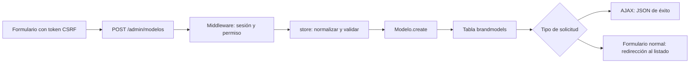

# Cómo circula una solicitud

## Abrir una tabla

```mermaid
flowchart LR
  A[Navegador: /admin/modelos] --> B[Sesión y administrador activo]
  B --> C[ModeloController.index]
  C --> D[Vista Blade HTML]
  D --> E[gestor.js solicita /admin/modelos/datos]
  E --> B2[Sesión y permiso]
  B2 --> C2[ModeloController.index]
  C2 --> F[Eloquent consulta modelos y marcas]
  F --> G[JSON con data]
  G --> H[DataTables dibuja filas]
```

El historial navega por páginas HTML. La petición de datos no agrega una entrada al historial. El endpoint se registra antes de las rutas con identificador para que `datos` no se interprete como un modelo.

## Guardar un modelo

En edición, `update()` obtiene el registro antes de validar y comprueba si cambiar su marca afectaría a vehículos existentes. Una validación fallida devuelve 422 en JSON o errores de formulario y redirección en una solicitud normal.

## Regla de negocio: contratación

`ContratoController` valida el formato de los datos y consulta `ReglasContrato::revisar()`. Ese servicio comprueba las condiciones del trabajador y las fechas. El modelo `Contrato` representa la tabla `contracts`. Las tareas de cierre de vencidos se declaran en `routes/console.php`; no dependen de que una persona abra una pantalla.

## Regla de negocio: asistencia

`AsistenciaController` recibe datos manuales o de marcación. `ServicioAsistencia` coordina el registro y `ResolverTurno` interpreta el turno. Las pruebas de `CorreccionesDeAuditoriaTest`, `ReglasDeNegocioTest` y `Avance02RestriccionesTest` comprueban casos de asistencia. Antes de modificar turnos nocturnos, revise tanto la fecha de marcación como la fecha del turno.
