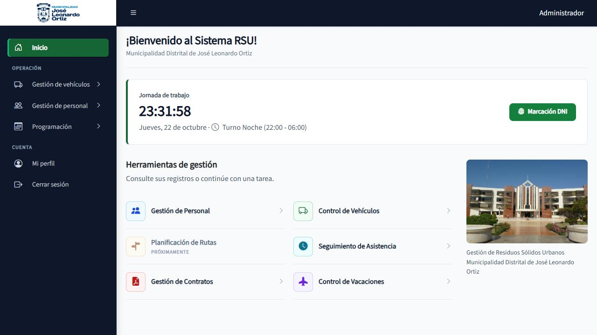

# Informe de modernización progresiva

Fecha de revisión: 22 de octubre de 2026, America/Lima. Rama: `codex/modernizacion-rsu`.

Esta entrega implementa una primera etapa transversal y deja un registro de las verificaciones y del trabajo restante. No declara terminada una auditoría exhaustiva ni el rediseño individual de cada pantalla.

## Diagnóstico y arquitectura

El repositorio utiliza Laravel **12.69.3**, Jetstream **5.5.3**, Livewire **3.8.10** y AdminLTE **4.0.1**, según `composer.lock`. PHP ejecutado: **8.4.22**; requisito del proyecto: **8.2+**. Vite compila Tailwind 3 y Axios. El panel principal utiliza Blade, Bootstrap, DataTables y archivos públicos propios; Jetstream conserva su circuito de assets Vite.

La arquitectura original ya separaba controladores administrativos, vistas por módulo, modelos SQL y servicios de negocio. Había 160 rutas registradas. No había documentación educativa en `docs/`; README mezclaba instrucciones del proyecto con la presentación genérica de Laravel. `package-lock.json` tenía un cambio previo del usuario: se conserva fuera de los commits de esta entrega.

La arquitectura resultante mantiene carpetas y namespaces. Añade 15 rutas de datos, una Gate de acceso y documentación local. El mapa explicado está en [MAPA_DEL_PROYECTO](MAPA_DEL_PROYECTO.md). No se cambiaron migraciones históricas, nombres SQL ni dependencias.

## Comparación concreta

| Antes | Después |
|---|---|
| Página y tabla consultaban `/admin/modelos` | La tabla consulta `/admin/modelos/datos`; se aplica a los 15 listados |
| Representaciones HTML/JSON sin Vary específico | `Vary: Accept, X-Requested-With` y panel privado sin almacenamiento HTTP |
| Estado de cuenta comprobado al iniciar sesión | También se comprueba en cada solicitud administrativa |
| Seeder reemplazaba nombre y contraseña existentes | `firstOrCreate` conserva la cuenta existente |
| Dos implementaciones del encabezado | El partial reutiliza el componente Blade existente |
| Inicio con banner degradado y presentación dominante | Jornada, marcación y tareas primero; fotografía secundaria |
| Cancelar rojo y edición con icono blanco sobre ámbar | Cancelar neutral e icono de edición oscuro |
| Login con acción degradada y mensajes sin asociación ARIA | Acción verde plana y mensajes asociados a sus campos |
| README con plantilla de Laravel y sin guías locales | README del producto y guías enlazadas en español |

Se eliminaron bloques CSS del inicio anterior después de comprobar que no tenían referencias en vistas, JavaScript ni pruebas. No se movieron archivos para imitar la imagen conceptual.

## Navegación

La evidencia y los contratos están en [NAVEGACION_Y_RUTAS](NAVEGACION_Y_RUTAS.md). La causa técnica identificada es compartir URL entre representaciones sin indicar la variación a la caché. No se reprodujo el fallo intermitente antes del cambio y, por ello, no se presenta una captura del defecto original.

La solución separa las peticiones actuales de datos, protege la caché de las llamadas antiguas y mantiene intactos sus formatos. La compatibilidad AJAX del `index` sigue disponible. No se interceptó ni bloqueó el historial.

En el navegador integrado sobre `http://127.0.0.1:8000` se verificó:

1. Acceso con la cuenta de prueba proporcionada por el usuario.
2. Modelos usa `data-url-listado` terminado en `/datos`.
3. Buscar `Atego` devuelve un resultado entre 12 registros.
4. Abrir Marcas, volver con Atrás, avanzar con Adelante y recargar muestra HTML y tablas.
5. Segunda página de Modelos: registros 11 a 12 de 12.
6. Abrir el modal Nuevo modelo y cerrarlo sin escribir registros.
7. Inicio rediseñado conserva reloj, turno, marcación y accesos.

No se probó el botón físico del mouse, otros motores de navegador ni restauración de una sesión completa del navegador. La prueba realizada del historial es real, adicional a las pruebas HTTP.

## Seguridad, validaciones y datos

`administrar-panel` requiere cuenta activa y `usertype_id` nulo en todas las rutas del panel. Se probó denegar HTML, JSON y escritura tras desactivar una sesión existente, y denegar acceso al personal. No se alteraron reglas de contratación, vacaciones o marcación.

El seeder dejó de sobrescribir credenciales. `InicializacionTest` comprueba hash y nombre originales. Se conservaron validaciones existentes de Modelos: marca válida, unicidad por marca, formatos, límites y restricciones de vehículos. Las nuevas pruebas cubren datos faltantes, duplicados, actualización, baja repetida y filtros inválidos. No se crearon validaciones de negocio arbitrarias.

Se revisaron el filtrado de campos de bitácora, las cabeceras existentes y el circuito de autenticación. No es una prueba de penetración ni una garantía sobre todo el código.

No se ejecutaron migraciones sobre la base de trabajo. Se preparó una SQLite separada para intentar la revisión en puerto 8011; el navegador no pudo conectarse a ese puerto y se utilizó el servidor existente en 8000 para comprobaciones de lectura. La base temporal no forma parte de Git. Las pruebas HTTP usan SQLite en memoria.

## Interfaz y legibilidad

El sistema visual está documentado en [DESIGN.md](../DESIGN.md). Se mantienen identidad municipal, fuentes locales y componentes instalados. Los cambios compartidos alcanzan los listados y formularios que usan esas clases; Inicio y login recibieron cambios específicos. Los módulos restantes necesitan una revisión visual individual antes de declarar completo el rediseño.

Ejemplos de simplificación: un include de cabecera delega al componente existente; la inicialización usa `firstOrCreate` en vez de actualizar datos ajenos al propósito de crear; las consultas de las nuevas rutas reutilizan el `index` existente sin duplicar su preparación de filas. Las reglas complejas siguen en servicios con nombres del dominio.

Se trazaron recorridos completos de Modelos, contratación y asistencia en [FLUJO_DE_FUNCIONAMIENTO](FLUJO_DE_FUNCIONAMIENTO.md). Las guías permiten localizar interfaz, entrada, validación y guardado sin inventar una organización nueva.

[Comparar con el inicio anterior](capturas/inicio-antes.png).

## Pruebas y verificaciones

| Comprobación ejecutada | Resultado |
|---|---|
| Suite inicial `php artisan test --compact` | 150 aprobadas, 1 fallida, 6 omitidas, 1 incompleta; faltaba manifest de Vite |
| `npm run build` | Correcto; se generó manifest y assets |
| Suite después de los cambios | 159 aprobadas, 6 omitidas, 1 incompleta; 1672 aserciones |
| `php vendor/bin/pint --test` completo y comprobación de archivos modificados | Correcto tras aplicar formato |
| `git diff --check` | Sin errores de espacios tras normalizar los archivos editados |
| `php artisan route:list -v` y revisión de Modelos | Controladores y middleware resueltos; ruta fija de datos antes del recurso |
| Parseo PostCSS de los tres CSS propios | Correcto; comprueba sintaxis, no apariencia |
| Historial, búsqueda, paginación y modal en navegador | Verificaciones descritas arriba |
| `composer audit --locked` | Sin avisos de vulnerabilidad encontrados al consultar el registro |
| `npm audit` | 8 vulnerabilidades: 5 altas y 3 moderadas, en dependencias de desarrollo |

Las omisiones corresponden a opciones de Jetstream deshabilitadas; la prueba incompleta preexistente espera un dashboard de indicadores aún no implementado (`RSUOperationalWorkflowTest::test_dashboard_command_center_contract_and_kpis`). No se inventaron indicadores para convertirla artificialmente en aprobada.

Los comandos que encontraron restricciones de archivos o red se repitieron con acceso autorizado. Una compilación correcta no certifica accesibilidad; SQLite no certifica concurrencia en MySQL.

## Problemas priorizados pendientes

1. **Dependencias de desarrollo:** npm reporta agotamiento de pila en `braces` y agotamiento de CPU en `postcss-selector-parser`, propagados por Tailwind y sus herramientas. La solución automática propone Tailwind 4 y cambios incompatibles de typography. Requiere una migración específica, compilación y regresión del perfil; no se aplicó `audit fix --force` ni se alteró el lockfile del usuario. Los avisos describen riesgo al procesar patrones/selectores no confiables; no equivalen por sí solos a un endpoint explotable en producción.
2. **Revisión visual restante:** móvil, zoom, lectores de pantalla, mensajes y estados vacíos de cada módulo; no se certifica WCAG global.
3. **Persistencia y concurrencia:** ejecutar los flujos relevantes sobre MySQL de prueba con el mismo esquema del despliegue. No hay resultados de carga ni mediciones SQL de producción.
4. **Dashboard:** el contrato futuro de indicadores ya estaba incompleto. Inicio ahora es más claro, pero no agrega métricas cuyo significado operativo no esté acordado.
5. **Volumen de catálogos:** varios listados cargan todas las filas; Asistencias ya pagina en servidor. Medir antes de añadir paginación a los demás o caché.
6. **Compatibilidad antigua:** retirar la negociación AJAX del `index` solo después de confirmar consumidores; las tablas de esta aplicación ya usan `/datos`.

## Usar y mantener

Siga [README](../README.md) para instalación, [GUIA_DE_MODIFICACIONES](GUIA_DE_MODIFICACIONES.md) para cambios y reversión, y [GUIA_DE_MODULOS](GUIA_DE_MODULOS.md) para el recorrido de cada módulo. Revise los commits de esta rama antes de integrar. No hay despliegue ni publicación en esta entrega.

## Revisión visual del 23 de octubre de 2026

Tras la observación del usuario de que el primer pase era demasiado simple, se sustituyó la dirección visual por una composición más propia y componentes inspirados en el acabado de shadcn/ui. Esta revisión prevalece sobre la descripción visual inicial del informe; la dirección vigente está en `DESIGN.md`.

El acceso integra fotografía municipal, titular breve y formulario delineado. El panel adopta tema claro, bordes precisos, acciones de fila discretas, tablas sin bandas, modales blancos, sugerencias con acabado de popover y confirmaciones coherentes. Se desactivó el preloader visual de pantalla completa y se diferenció la variante destructiva de la de cancelación. No se añadieron paquetes, no se migró a React y no se modificaron reglas ni tablas de negocio.

Se comprobaron login y modal a 390×844, además de acceso, navegación, tabla y modal en escritorio. Se ajustaron el contraste del menú y los placeholders; no se certifica accesibilidad global. Las capturas nuevas están enlazadas desde `DESIGN.md`.

La suite detectó dos pruebas preexistentes dependientes de la hora: intentaban registrar a las 11:00 y 12:30 antes de que llegaran esas horas. Se fijó el reloj a las 13:00 dentro de esos dos tests, conservando la validación real contra asistencias futuras. Después: **159 aprobadas, 6 omitidas y 1 incompleta preexistente; 1673 aserciones**. Pint completo aprobado. La prueba de variante de botón comprueba además la clase de acción destructiva.

Los pendientes de seguridad de dependencias y la regresión sobre MySQL descritos en el informe inicial permanecen sin cambios. El `package-lock.json` previo del usuario continúa fuera de estos cambios.
