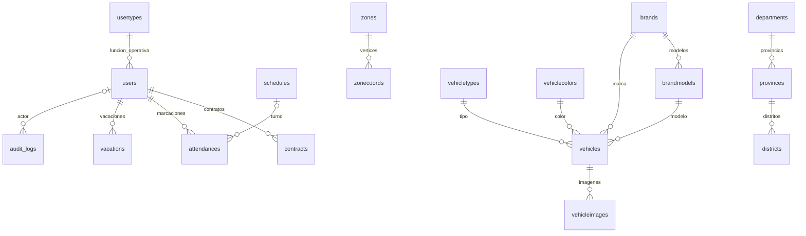

# Mapa técnico actual del proyecto RSU

> Actualizado tras la implementación: [organización, contratos y verificación](IMPLEMENTACION_Y_VERIFICACION.md). `Requests/Admin`, middleware de escrituras, versiones y Vite forman parte del flujo actual. El mapa y el inventario reflejan las fuentes reorganizadas.

Snapshot documental: 23/10/2026. El inventario exacto de archivos propios, clases/métodos PHP, tablas declaradas y archivos de pruebas se conserva en `inventario-proyecto.json`. Se excluyen dependencias, datos operativos, `.env`, cachés y artefactos compilados. Complementa, sin reemplazar, `MAPA_DEL_PROYECTO.md` y las guías existentes.

## Arquitectura y entradas

Monolito Laravel 12 (restricción Composer), PHP >=8.2, Jetstream/Fortify, Livewire 3, Sanctum y AdminLTE 4. Blade sirve HTML y controladores sirven JSON para DataTables. JavaScript y CSS propios viven en `resources` y se compilan con Vite. El panel conserva librerías publicadas de AdminLTE y el perfil utiliza su entrada Jetstream separada. Versiones exactas instalables: `composer.lock` y `package-lock.json`; no confundirlas con los rangos de manifests.

Flujo: `public/index.php` → `bootstrap/app.php` → middleware web/autenticación/Gate → `routes/web.php` → middleware de escritura y versión → controlador Admin → Request/servicio/modelo → BD → JSON o vista/redirect → `Tads.Gestor` y módulo de pantalla. Perfil y autenticación siguen rutas registradas por paquetes; no aparecen todas explícitamente en `web.php`.

`/` redirige a `/admin`; `/dashboard` también. `/admin/*` requiere sesión y Gate `administrar-panel` (cuenta activa sin tipo de personal). `/up` es salud. `routes/console.php` define cierre de contratos y recuperación de contraseña de administrador; el cierre corre 00:05 con `withoutOverlapping`. `artisan` es entrada CLI. Zona horaria en `config/app.php`: America/Lima.

## Estructura por responsabilidad

- `app/Http/Controllers/Admin`: 16 controladores. Los 15 recursos del panel tienen endpoint `/datos`; Inicio es dashboard y Bitácora es consulta. `Concerns/RespondeAjax` unifica respuestas y archivos; `BuscaEnCatalogo` unifica búsquedas.
- `app/Services`: nueve servicios: `SeguridadAdministrativa`, `GaleriaVehiculos`, `ReglasContrato`, `ReglasVacacion`, `ServicioAsistencia`, `ResolverTurno`, `ReglasZona`, `Ubigeo`, `CargadorFeriados`.
- `app/Http/Requests/Admin`: validación compartida por alta y edición de los ocho flujos complejos (incluida galería); `datos()` se ejecuta bajo el bloqueo de la petición.
- `app/Models`: entidades Eloquent con nombres españoles y tablas mayormente inglesas; `Concerns/Auditable` agrega eventos y `Concerns/Versionado` mantiene versiones de edición. `User` y `Personal` comparten `users`, pero tienen responsabilidades y scopes diferentes.
- `app/Providers`: `AppServiceProvider` define Gate y contraseñas; `FortifyServiceProvider` configura autenticación, recuperación y límites; `JetstreamServiceProvider` integra acciones y permisos del paquete.
- `app/Actions/Fortify`: creación, cambio/reset de clave, perfil y reglas de contraseña. Registro público deshabilitado por configuración aunque exista la acción.
- `app/Actions/Jetstream/DeleteUser`: autoeliminación desde perfil. `app/Support/HashFicticio`: comparación para identidad inexistente. `app/Http/Responses/RespuestaUniformeDeRecuperacion`: respuesta de recuperación. `CabecerasDeSeguridad`: cabeceras y no-store del panel.
- `app/Livewire/Perfil/ActualizarInformacion`: reutiliza el formulario Jetstream, conservando y refrescando la versión de edición.
- `app/View/Components`: layouts App/Guest. `resources/views/components/admin`: componentes del panel; componentes Jetstream restantes en carpeta superior.
- `database/migrations`: definición histórica de tablas e índices; últimas migraciones añaden integridad, bitácora y snapshot de asistencias. `database/seeders`: catálogos y demostración; `DatabaseSeeder` cambia carga según entorno. `database/factories/UserFactory`: cuentas de tests.
- `resources/views/admin`: carpetas por módulo con `index/create/edit/_form`, excepciones: dashboard directo, bitácora solo index, asistencia añade marcación y personal añade historial de contratos. `admin/partials`: adaptadores y buscadores comunes.
- `resources/views/auth`, `profile`, `api`, `layouts`, `components`: pantallas y piezas Fortify/Jetstream. La existencia de una vista API no implica API habilitada.
- `resources/js/admin/compartido`: peticiones, errores, presentación, buscadores, reloj, validación, tablas e inicio de módulos.
- `resources/js/admin/modulos`: un archivo por módulo, incluyendo turnos, feriados, usuarios y bitácora. `panel.js` importa las piezas en orden y `layouts/admin.blade.php` las carga mediante Vite.
- `resources/css/admin`: panel, menú y acceso. `public/images`: marca/placeholders; `public/vendor`: terceros y mapas; `public/uploads`: archivos de usuarios. No hay fuentes propias duplicadas en `public/js` o `public/css`.
- `resources/js`, `resources/css`, `vite.config.js`, `tailwind.config.js`, `postcss.config.js`: compilación Vite. `public/build` es salida generada.
- `config`: app/auth/session/cache/database/queue/mail/filesystems/logging/services/sanctum; `fortify`/`jetstream` controlan features; `adminlte` menú/assets; `proyecto` límites de negocio; `ubigeo` ubicación y cajas geográficas.
- `bootstrap`: arranque/proveedores y cachés generadas; `storage`: logs, sesiones, archivos internos y vistas compiladas; no son fuentes de reglas.
- `lang`: traducciones; `tests/Feature`: subcarpetas Negocio, Seguridad, Navegacion y Arquitectura; `tests/Concurrencia`: procesos MySQL; `tests/Unit`: prueba básica. `.github/workflows/pruebas.yml`: Composer, npm/build, Pint y tests con SQLite en Ubuntu, más un trabajo independiente con MySQL 8.
- `docs`, `README.md`, `DESIGN.md`: navegación y decisiones técnicas, contrato visual y documentación operativa. `.editorconfig`, `.gitignore`, `.gitattributes`: convenciones del repositorio. `.env.example`: plantilla de entorno; `.env`: privado, no inspeccionado.
- `vendor`, `node_modules`, `.git`: dependencias e historia; no editar para corregir el producto.

## Mapa de módulos: ruta → controlador → datos → interfaz

Todas las rutas siguientes llevan prefijo `/admin`. Para los CRUD, revisar `store/update/destroy` y `_form` antes de cambiar reglas. El inventario JSON añade métodos y números de línea.

- `colores` → `ColorController` → `ColorVehiculo/vehiclecolors` → `admin/colores`, `resources/js/admin/modulos/colores.js`; buscador `colores/buscar`.
- `marcas` → `MarcaController` → `Marca/brands` → `admin/marcas`, `resources/js/admin/modulos/`; logo mediante `RespondeAjax`; buscador `marcas/buscar`.
- `modelos` → `ModeloController` → `Modelo/brandmodels` → `admin/modelos`, `resources/js/admin/modulos/`; `modelos/buscar` filtra marca, `modelos/verificar` revisa duplicados.
- `tipos-vehiculo` → `TipoVehiculoController` → `TipoVehiculo/vehicletypes` → `admin/tiposvehiculo`, `resources/js/admin/modulos/`; buscador.
- `vehiculos` → `VehiculoController` → `Vehiculo/vehicles`, `ImagenVehiculo/vehicleimages` → `admin/vehiculos`, `resources/js/admin/modulos/vehiculos.js`; GET/POST `vehiculos/{vehiculo}/imagenes`.
- `tipos-personal` → `TipoPersonalController` → `TipoPersonal/usertypes` → `admin/tipospersonal`, `resources/js/admin/modulos/`; buscador; funciones del sistema con código estable.
- `personal` → `PersonalController` → `Personal/users` y relaciones → `admin/personal`, `resources/js/admin/modulos/personal.js`; `personal/buscar` según contexto y `personal/{persona}/contratos`.
- `contratos` → `ContratoController`, `ReglasContrato` → `Contrato/contracts` → `admin/contratos`, `resources/js/admin/modulos/contratos.js`; PATCH `{contrato}/estado`; sin ruta destroy.
- `asistencias` → `AsistenciaController`, `ServicioAsistencia`, `ResolverTurno` → `Asistencia/attendances` → `admin/asistencias`, `resources/js/admin/modulos/asistencias.js`; vista previa, pantalla/estado/POST de marcación (`resources/js/admin/modulos/marcacion.js`); sin show.
- `vacaciones` → `VacacionController`, `ReglasVacacion` → `Vacacion/vacations` → `admin/vacaciones`, `resources/js/admin/modulos/vacaciones.js`; PATCH aprobar/rechazar.
- `turnos` → `TurnoController`, `ResolverTurno` → `Turno/schedules` → `admin/turnos`, `resources/js/admin/modulos/`.
- `zonas` → `ZonaController`, `ReglasZona`, `Ubigeo` → `Zona/zones`, `ZonaCoordenada/zonecoords` → `admin/zonas`, `resources/js/admin/modulos/zonas.js`; mapa, verificar perímetro y dirección.
- `feriados` → `FeriadoController`, `CargadorFeriados` → `Feriado/holidays` → `admin/feriados`, `resources/js/admin/modulos/`; consultar y cargar lotes.
- `usuarios` → `UsuarioController` → `User/users` sin tipo → `admin/usuarios`, `resources/js/admin/modulos/`; perfil separado mediante Livewire/Jetstream.
- `bitacora` → `BitacoraController` → `Bitacora/audit_logs (incluye actor_name)` → `admin/bitacora`, `resources/js/admin/modulos/`; lectura y filtros.
- `/admin` → `InicioController` → bienvenida, accesos por módulo y cierre de contratos vencidos → `admin/inicio.blade.php`, `resources/js/admin/modulos/inicio.js`. No hay cálculo de indicadores operativos en este controlador.

Muchos `show` de recursos existen en el registro de rutas pero abortan 404. Zona sí devuelve detalle. No asumir que todos los métodos resource representan una pantalla operativa.

## Relaciones y restricciones de datos

`users.usertype_id=NULL` representa administrador; con valor representa personal. FKs de contrato/asistencia/vacación apuntan a `users`, por lo que pertenencia a personal también requiere reglas de aplicación. `registered_by`, `resolved_by` y actor de bitácora son relaciones adicionales hacia `users` que el diagrama simplifica. `holidays` es calendario independiente. Tablas de infraestructura incluyen sesiones, password reset, cache/cache locks, jobs/batches/fallidos, tokens y passkeys; consultar lista exacta declarada en JSON.

Unicidad relevante: DNI/correo/licencia, código/placa de vehículo, nombres de catálogos/turnos/zonas, color hexadecimal, nombre y código del modelo por marca, fecha de feriado, zona+posición y persona+turno+jornada+tipo de asistencia. Contratos usa `active_user_id` generado para un activo por persona. MySQL añade FK compuesta modelo/marca, CHECKs y RESTRICT de historial; SQLite omite parte de esas defensas. Las tres filas de `bloqueos` serializan conjuntos administrativos, de turnos y zonas. Las columnas `version` detectan ediciones obsoletas. No existe restricción SQL que por sí sola resuelva todos los solapes o el cupo anual.

## Flujos que deben cambiar juntos

- Marcación manual/DNI/edición/baja → controlador + servicio + renumeración + turno/jornada + contratos/vacaciones + tests. Cambiar solo el formulario crea reglas distintas por camino.
- Contrato/personal/vacaciones → invariantes compartidos por persona; revisar activación/desactivación y cierre automático además del CRUD.
- Galería → conteo, selección de perfil, archivos y transacción; borrar vehículo debe coordinarse con cargas.
- Seguridad → login, Gate, panel de usuarios, perfil, recuperación, 2FA/passkeys y consola. `User` no tiene el trait de auditoría de `Personal`.
- Zona → coordenadas de frontend, precisión de guardado, geometría/solape y ubicación; consultas a terceros no deben confundirse con la validación final.
- Feriados → consulta remota, respaldo local, carga por lotes/manual y política de existentes.

## Integraciones y operación

HTTP de servidor: Nager.Date (feriados) y Nominatim (respaldo de búsqueda). Navegador: mosaicos OpenStreetMap, Nominatim y Overpass en herramientas de zonas. Fallas de red deben permitir distinguir disponibilidad del servicio de validez del dato. `Ubigeo` consulta tablas con DB facade, sin modelos específicos para esas tablas.

Composer define setup/dev/test; `npm run dev/build` gestiona assets; `.github/workflows/pruebas.yml` es CI, no un despliegue completo. No se identificó implementación propia de optimización/programación de rutas, trabajos de dominio en `app/Jobs`, API pública propia o sistema de roles granulares. Los textos de reserva y scopes de reemplazo preparan consultas, no constituyen planificación persistida.

## Estado del checkout y cómo reutilizar este mapa

Al comenzar había cambios locales en `package-lock.json`, `resources/css/admin/menu.css`, `resources/css/admin/panel.css` y `public/images/logo-sistema.svg`. Se conservaron. El snapshot JSON enumera archivos y símbolos sin secretos; no asegura que los cambios locales estén confirmados en Git.

Para el siguiente trabajo: partir de este mapa, leer `ANALISIS_VALIDACIONES_Y_CONCURRENCIA.md`, elegir IDs H01–H14, ubicar rutas y métodos en JSON y revisar todas sus entradas antes de editar. Releer fuentes si cambió el checkout: este snapshot no se actualiza automáticamente.

Verificación posterior: 192 pruebas HTTP/reglas sin fallos, build Vite y smoke de navegador sobre SQLite aislado. La falta de acceso del sandbox a `vendor/autoload.php` se resolvió ejecutando PHP con acceso autorizado. No se modificó la base operativa; se ejecutaron ocho pruebas concurrentes y la regresión HTTP en una instancia MySQL 8.4 descartable, con configuración/CI separados. La aceptación del despliegue y su respaldo operativo siguen siendo tareas del entorno de producción.
